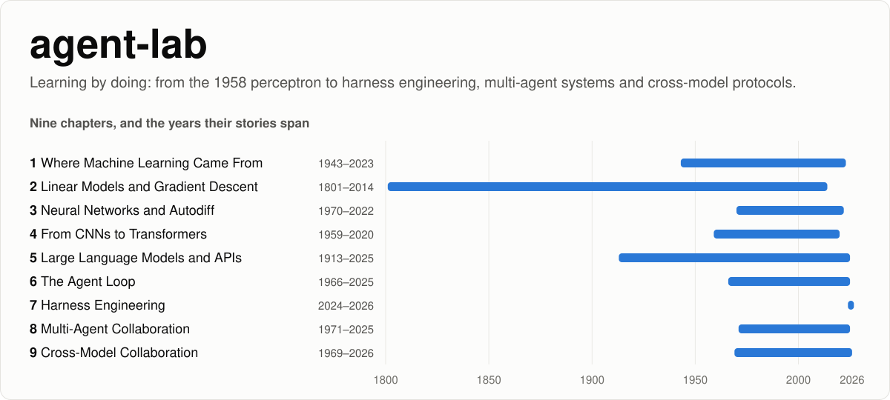

<picture>
  <source media="(prefers-color-scheme: dark)" srcset="assets/banner-dark.svg">
  
</picture>

[](https://github.com/Jims2333/agent-lab/actions/workflows/ci.yml)

[](./LICENSE)
[](./LICENSE-docs.md)
[](https://codespaces.new/Jims2333/agent-lab)

**Learning by doing: from the 1958 perceptron to harness engineering, multi-agent systems, and getting Claude, GPT and DeepSeek to work together.**

In 1958, when *The New York Times* reported on the first machine that could learn, the headline was *"New Navy Device Learns By Doing."*
This course follows the same idea. Every chapter first tells **stories that really happened**, then has you **run code** that
recreates the key moment, and only then explains the **concepts**.

> 🀄 This course was first written in Chinese. The original Chinese edition is kept on the
> [`chinese-edition`](https://github.com/Jims2333/agent-lab/tree/chinese-edition) branch.

## Contents

- [Course map](#course-map)
- [Side quests](#side-quests)
- [Quick start](#quick-start)
- [Using real models](#using-real-models)
- [How the course is written](#how-the-course-is-written)
- [After the course](#after-the-course)
- [Repository layout](#repository-layout)
- [Contributing](#contributing)
- [License](#license)
- [Citation](#citation)

## Course map

| Chapter | Stories | What you build |
|---|---|---|
| [1 · Where Machine Learning Came From](./01-ml-origins/) | 1943–2023: the perceptron, the AI winters, backpropagation, ImageNet, the Transformer, agents | Recreate the 1958 perceptron, the 1969 XOR dead end and 1986 backpropagation |
| [2 · Linear Models and Gradient Descent](./02-linear-models/) | 1801–2014: finding Ceres again, the fight over least squares, Cauchy's descent method, Galton's "regression", LMS, Adam | Hand-written gradient descent on Galton's real data; batch vs stochastic gradient descent |
| [3 · Neural Networks and Autodiff](./03-neural-nets/) | 1970–2022: reverse-mode autodiff, universal approximation, vanishing gradients, ReLU, dropout, deep learning frameworks | Write an autodiff engine from scratch and train a network with it; watch gradients vanish and explode in a 30-layer network |
| [4 · From CNNs to Transformers](./04-cnn-to-transformer/) | 1959–2020: the cat's visual cortex, the Neocognitron, ResNet, LSTM, the birth of attention, the Transformer, ViT | Hand-written convolution and attention; RNN vs attention; assemble a complete Transformer block |
| [5 · Large Language Models and APIs](./05-llm-and-api/) | 1913–2025: Markov counting letters, Shannon guessing letters, word vectors, BPE, scaling laws, RLHF, DeepSeek-R1 | Train an n-gram model and a BPE tokenizer, play with sampling settings, call Claude / GPT / DeepSeek through one client |
| [6 · The Agent Loop](./06-agent-loop/) | 1966–2025: ELIZA, Shakey, SHRDLU, ReAct, function calling, SWE-bench, Claude Code | A mini ELIZA; tools defined with JSON Schema and run safely; a ReAct agent from scratch |
| [7 · Harness Engineering](./07-harness/) | 2024–2026: SWE-agent's ACI, the Replit database deletion, context engineering, hand-offs for long-running agents, OpenAI's harness engineering | Give a coding agent a sandbox, a permission gate, budgets, context management, an acceptance check and a log; compare five context strategies |
| [8 · Multi-Agent Collaboration](./08-multi-agent/) | 1971–2025: the Actor model, Hearsay-II's blackboard, the Contract Net, *The Society of Mind*, the 2023 wave, the MAST failure taxonomy, Anthropic vs Cognition | Parallel orchestrator–workers research; Contract Net bidding; multi-agent debate; a writer–reviewer loop that runs tests in a subprocess |
| [9 · Cross-Model Collaboration](./09-cross-model/) | 1969–2026: RFC 1 written in a bathroom, TCP/IP, the Web, LSP, MCP, A2A | Routing and failover across three vendors; cross-vendor checking; a mini A2A in the standard library; capstone: three vendors build a study card together |

## Side quests

| Side quest | What it covers |
|---|---|
| [1 · How Do Two AIs "Talk"?](./side-quests/ai-talks-to-ai/) | How Claude can chat with DeepSeek or GPT: stateless APIs, role flipping, a relay harness, splitting work between agents, MCP and A2A. Includes a runnable `relay.py` |
| [2 · A Bridge Between the ChatGPT and Claude Apps](./side-quests/app-bridge/) | Letting the two desktop apps pass messages: how programs talk to each other, the MCP protocol underneath, local vs remote servers, tunnels. Includes a runnable MCP mailbox server |

## Quick start

You need Python 3.10 or newer. The first four chapters use only numpy; chapters 5–9 use only the standard library in mock mode.

```bash
git clone https://github.com/Jims2333/agent-lab.git
cd agent-lab
pip install -r requirements.txt

python tools/run_labs.py          # run every lab once (about a minute, no API key needed)
cd 01-ml-origins && python perceptron_1958.py   # or start reading and run labs one by one
```

Or click **Open in GitHub Codespaces** above to get a ready-to-run environment in your browser.

<details>
<summary>Every lab, chapter by chapter</summary>

```bash
# Chapter 1
cd 01-ml-origins
python perceptron_1958.py
python xor_1969.py
python backprop_1986.py

# Chapter 2
cd ../02-linear-models
python ceres_1801.py
python gradient_descent_1847.py
python galton_1886.py
python lms_1960.py

# Chapter 3
cd ../03-neural-nets
python autograd.py
python mlp_moons.py
python vanishing_gradient.py

# Chapter 4
cd ../04-cnn-to-transformer
python convolution.py
python attention.py
python rnn_vs_attention.py
python transformer_block.py

# Chapter 5 (mock model by default; no API key needed)
cd ../05-llm-and-api
python markov_1913.py
python bpe_tokenizer.py
python sampling.py
python chat_api.py

# Chapter 6
cd ../06-agent-loop
python eliza_1966.py
python tools.py
python react_agent.py

# Chapter 7
cd ../07-harness
python harness.py
python context_budget.py

# Chapter 8
cd ../08-multi-agent
python orchestrator.py
python contract_net.py
python debate.py
python write_review.py

# Chapter 9 (add --live to use real models for the vendors whose keys you have set)
cd ../09-cross-model
python router.py
python cross_check.py
python a2a_mini.py
python capstone.py

# Side quest 1: two AIs chatting (mock mode, no API key needed)
cd ../side-quests/ai-talks-to-ai
python relay.py --show-history

# Side quest 2: see what an app and an MCP server say to each other (needs: pip install "mcp[cli]>=1.20,<2")
cd ../app-bridge
python wire_demo.py
```

</details>

## Using real models

From chapter 5 on, labs can call real models. Keys are read from environment variables only. Every lab still works without them.

| Vendor | Environment variable | Default model | Install |
|---|---|---|---|
| Claude | `ANTHROPIC_API_KEY` | `claude-opus-5-5` | `pip install "anthropic>=1.11"` |
| GPT | `OPENAI_API_KEY` | `gpt-5.5` | `pip install "openai>=1.0"` |
| DeepSeek | `DEEPSEEK_API_KEY` | `deepseek-v4-flash` | `pip install "openai>=1.0"` (OpenAI-compatible API) |

Use `--provider claude|gpt|deepseek` in chapters 5–8, and `--live` in chapter 9. In Codespaces, add the keys as Codespaces secrets.

> **Honest note:** every real-API code path was tested against a local mock server, but **not with real API keys**.
> If something breaks with a real model, please [open an issue](https://github.com/Jims2333/agent-lab/issues/new?template=bug_report.yml).

## How the course is written

**Stories are true.**
- People, dates, places and quotes all have sources, listed at the end of each chapter.
- Details that only one person reported are marked "according to X".
- Anything that can't be verified is left out.

**Story first, concepts last.** Concepts are explained at the end of each chapter, each linked to the story where it first appears.

**Code from scratch.** If it can be written with numpy or the standard library, it is, so you see the idea before you reach for a framework.

**Every lab runs.** Random seeds are fixed so the output is reproducible, labs that use a language model default to a mock model, and every script ends with a few *Think about it* questions.

## After the course

After nine chapters you have a box of toy parts: an autodiff engine, attention, a tokenizer, a ReAct loop, a harness,
multi-agent orchestration, an adapter layer and a mini A2A. Some ways to keep going:

1. **Run it again with real models.**
   - Set a key for one or two vendors and run chapters 5–9 with `--provider` or `--live`.
   - Compare with the mock scripts. Real models won't make the scripted mistakes, and that difference is a lesson in itself.
2. **Build your own small eval set.** Chapter 9's routing table and cross-checking both depend on knowing which model is good enough for which task, and only your own test data can answer that.
3. **Swap the hand-made parts for real tools.** Replace autodiff with PyTorch, the model calls with each vendor's official SDK, MCP with the official `mcp` Python SDK, and A2A with `a2a-sdk`. Because you know what they do inside, the switch will be quick.
4. **Read the original sources.** Every chapter ends with first-hand references; the papers and original writing are often better than any retelling.
5. **Build something of your own.** For example, combine side quest 2's MCP mailbox with chapter 9's A2A, or give chapter 7's harness a permission gate that asks you before delegating work to an outside agent.

## Repository layout

```
agent-lab/
├── 01-ml-origins/            Chapter 1: stories → labs → concepts → references
├── 02-linear-models/         Chapter 2 (data/galton_1886.csv: Galton's real 1886 height data)
├── 03-neural-nets/           Chapter 3 (autograd.py: a hand-written autodiff engine)
├── 04-cnn-to-transformer/    Chapter 4
├── 05-llm-and-api/           Chapter 5 (data/corpus.txt: the text of chapters 1–4, used as training data)
├── 06-agent-loop/            Chapter 6 (tools.py: tool specs + safe execution, reused later)
├── 07-harness/               Chapter 7
├── 08-multi-agent/           Chapter 8 (workers reuse chapter 6's ReAct agent)
├── 09-cross-model/           Chapter 9 (a2a_mini.py: a stdlib subset of A2A 1.0; capstone.py reuses chapters 6–9)
├── common/llm.py             Shared by chapters 5–9: one client for Claude / GPT / DeepSeek / mock
├── side-quests/
│   ├── ai-talks-to-ai/       Side quest 1: how two AIs chat
│   └── app-bridge/           Side quest 2: a bridge between the ChatGPT and Claude apps
├── tools/
│   ├── run_labs.py           Runs every lab with the mock model (used by CI)
│   └── check_links.py        Checks every relative link and #anchor (used by CI)
├── assets/                   Banner images
├── .github/                  CI workflow, issue forms, PR template
├── .devcontainer/            Codespaces / dev container setup
├── CONTRIBUTING.md · CODE_OF_CONDUCT.md · SECURITY.md · CITATION.cff
└── LICENSE (code: MIT) · LICENSE-docs.md (text: CC BY 4.0)
```

## Contributing

Fact corrections are the most valuable contribution: this course only works if every story is true.
See [CONTRIBUTING.md](./CONTRIBUTING.md), and use the issue forms for
[fact corrections](https://github.com/Jims2333/agent-lab/issues/new?template=fact_correction.yml),
[bugs](https://github.com/Jims2333/agent-lab/issues/new?template=bug_report.yml) and
[chapter ideas](https://github.com/Jims2333/agent-lab/issues/new?template=chapter_idea.yml).

## License

- **Code**: [MIT](./LICENSE).
- **Text**: [CC BY 4.0](./LICENSE-docs.md). Reuse, translate and remix it, with credit.

## Citation

If this course helps your teaching or writing, GitHub's **Cite this repository** button (from [CITATION.cff](./CITATION.cff))
gives you a ready-made citation.
